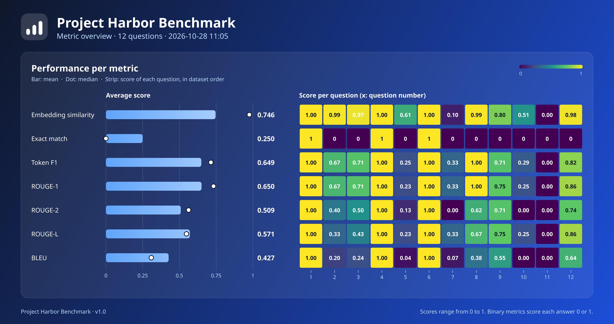

<div align="center">


# Project Harbor Benchmark

### A desktop benchmark for local LLMs, scored against a fixed question set.

**Load a dataset. Point it at your model. Get comparable scores.**

[](https://www.python.org/)
[](https://doc.qt.io/qtforpython-6/)
[](https://github.com/qdrant/fastembed)
[](https://pyinstaller.org/)
[](#quick-start)
[](LICENSE)

[Features](#features) · [Quick start](#quick-start) · [Usage](#usage) · [Metrics](#metrics) · [Architecture](#architecture) · [License](#license)

</div>

<br />

<div align="center">

</div>

<br />

Project Harbor Benchmark lets a team evaluate different LLM approaches on the same dataset in the same way. For each question, the app calls your model through an OpenAI-compatible endpoint (for example `http://127.0.0.1:1234/v1/chat/completions`), or through the native Anthropic or Gemini API, compares the answer with the expected one, and scores it from 0 to 1. The embedding model ships inside the app, so scoring works offline; only calls to a cloud provider need a connection and an API key.

## Features

- **Fully local scoring.** Point it at an LLM on your machine or a cloud API; the embedding model is bundled, and the dataset is a plain JSON file you choose.
- **Seven metrics.** Embedding similarity, Exact match, Token F1, ROUGE-1, ROUGE-2, ROUGE-L and BLEU. Switching metric after a run re-scores the stored answers without calling the LLM again.
- **Overview chart.** One PNG with every metric at once: mean, median and a per-question heat map.
- **Run statistics.** Median, highest and lowest score, response times, empty answers and average answer length.
- **JSON and CSV export** of every run.
- **Demo mode** with fixed sample data, so you can explore the app without an LLM or a dataset.
- **Native desktop app** for Linux (`.AppImage`) and Windows, built with Qt.

## Quick start

Download the latest build from the releases page (or from the `build` workflow artifacts), or run it from source:

```sh
python3 -m venv .venv
.venv/bin/pip install -r requirements-dev.txt
.venv/bin/python scripts/prefetch_model.py
.venv/bin/python main.py
```

`prefetch_model.py` downloads the embedding model (about 240 MB) into `models/`, which is what lets the app run offline afterwards.

To look around without any setup beyond the install, start the demo:

```sh
.venv/bin/python main_demo.py
```

## Usage

1. Open the app. A splash screen shows while the embedding model loads.
2. Click **Load dataset…** and pick your JSON file. Everything else stays disabled until a valid dataset is loaded.
3. Enter the LLM URL. **API key** and **Model** are optional for local servers, and the URL works without `http://`. The provider is picked from the URL (see [Supported providers](#supported-providers)).
4. Choose a **Metric** (default: Embedding similarity).
5. Click **Run** and follow the progress. The table and the metrics panel fill in when it finishes.
6. Use **Export** to save the result as JSON or CSV, and **Export chart…** to save the overview PNG.

Loading a new dataset clears the previous result. Changing the metric after a run recalculates the score column immediately from the answers already collected.

### Dataset format

The dataset is a JSON list of questions. See [`examples/questions.example.json`](examples/questions.example.json).

```json
[
  {
    "id": "1",
    "question": "What is the capital of Brazil?",
    "expected_answer": "The capital of Brazil is Brasília."
  }
]
```

`id` is optional; when missing, the position in the list is used. The dataset is never bundled with the app, so your team can share and version it separately.

### Demo mode

`main_demo.py` opens the same window with 12 sample questions and a simulated run. It makes no network calls. Export and Export chart write real files, but the numbers are sample data and must not be mistaken for real results. The fixed data lives in [`demo/demo_data.py`](demo/demo_data.py).

## Supported providers

The provider is chosen from the **URL**; there is no extra field.

| Provider | URL | API key | Model |
|----------|-----|---------|-------|
| OpenAI-compatible (OpenAI, LM Studio, Ollama, vLLM, OpenRouter, Groq…) | The full `…/chat/completions` URL | Optional (`Authorization: Bearer`) | Optional |
| Anthropic | `https://api.anthropic.com` (the path `/v1/messages` is added when missing) | Required (`x-api-key`) | Required, for example `claude-sonnet-4-5` |
| Google Gemini | `https://generativelanguage.googleapis.com` (the path `/v1beta/models/<model>:generateContent` is built from **Model**), or the full `…:generateContent` URL | Required (`x-goog-api-key`) | Required when the URL has no path |

Any URL containing `/chat/completions` is treated as OpenAI-compatible, including the compatibility endpoints of Anthropic and Google. Anthropic answers are capped at 4096 output tokens.

## Metrics

Every metric compares the LLM answer with `expected_answer` and returns a score from 0 to 1 per question.

| Metric | Per-question score | Notes |
|---|---|---|
| Embedding similarity | Cosine similarity between embeddings (negatives clamp to 0) | Captures meaning and tolerates paraphrase. Multilingual model bundled. |
| Exact match | 0 or 1 | SQuAD-style normalization: lowercase, no punctuation, no `a`/`an`/`the`, collapsed whitespace. |
| Token F1 | F1 over normalized tokens | Same normalization as Exact match. Counts repeated tokens. |
| ROUGE-1, ROUGE-2 | F-measure over unigrams and bigrams | Word tokenization (`\w+`), lowercase, no stemming. |
| ROUGE-L | F-measure over the longest common subsequence | Same tokenization. |
| BLEU | Sentence BLEU (`sacrebleu`, 0 to 1 scale) | The panel also shows corpus BLEU, the usual translation metric. |

Binary metrics (Exact match) show correct and incorrect counts instead of median, highest and lowest score.

Things to keep in mind when reading the scores:

- Exact match and F1 are designed for short answers. Chat models tend to answer in full sentences, which lowers these scores even when the answer is right. Either write the expected answers in the same style or configure the LLM to answer briefly.
- The ROUGE tokenizer accepts accented letters, unlike the original `rouge-score`, which only considers `a-z` and `0-9`. Results on non-English text can therefore differ from it.
- Sentence BLEU is unstable on very short answers. Corpus BLEU is more reliable for comparing approaches.
- Applying a benchmark's formula to your own dataset does not reproduce that benchmark's published score; it only reuses the calculation.

### Overview chart

**Export chart…** renders a PNG in which every row is a metric: its name, a bar for the mean with a dot for the median, and a heat-map strip with one cell per question (purple at 0, yellow at 1, in dataset order). Because rows are metrics, you can read vertically where they agree or disagree on the same question. Up to about 45 questions the value appears inside each cell; beyond that only colors remain and the axis labels are spaced out. The chart is drawn with Qt itself, so it needs no plotting library, and it is only available after a run.

## Architecture

Project Harbor Benchmark follows Clean Architecture with an MVC presentation layer. Dependencies point inward: `presentation → domain ← data`.

```
domain/             entities, repository and gateway interfaces, use cases,
                    and the pure-Python scoring methods (domain/scoring)
data/               JSON dataset reader, result exporter, OpenAI-compatible, Anthropic and Gemini HTTP
                    gateways, scoring methods with heavy dependencies
                    (embedding similarity, BLEU)
presentation/
  controllers/      evaluation and startup controllers (background threads)
  views/            splash screen, main window, metrics panel, overview chart,
                    theme (PySide6)
demo/               fixed data and simulated components for main_demo.py
examples/           sample dataset
scripts/            model prefetch and AppImage build
packaging/linux/    AppRun, .desktop entry and icon
tests/
```

- **Use cases** each expose a single action: `RunEvaluation`, `LoadQuestions`, `RescoreResult`, `BuildMetricOverview`, `ExportResult` and `PrepareScoringMethods`.
- **Scoring** goes through the `ScoringMethod` interface (`identifier`, `display_name`, `score_kind`, `score()`, `prepare()` and an optional `corpus_score()`), so adding a metric means adding one class and registering it.
- **Controllers** are thin: they run use cases on background threads and hand results to the views. `EvaluationController.shutdown()` cancels and joins the worker on exit, so closing the window mid-run is safe.
- **Views** only display data and forward user actions. Colors live in `presentation/views/branding.py` and the Qt stylesheet in `presentation/views/theme.py`.

## Contributing

Issues and pull requests are welcome. Please run `python -m pytest` before opening a pull request, and keep each change focused on a single behavior.

## License

Released under the [MIT License](LICENSE).
